# PokeWebGochi

**A Pokémon virtual pet in your browser.** Raise one of the original 151, battle and catch wild Pokémon, fill your Pokédex, play mini games and meet your buddies. Free, with nothing to install.

### [▶ Play now at pokewebgochi.3dprintsos.com](https://pokewebgochi.3dprintsos.com)

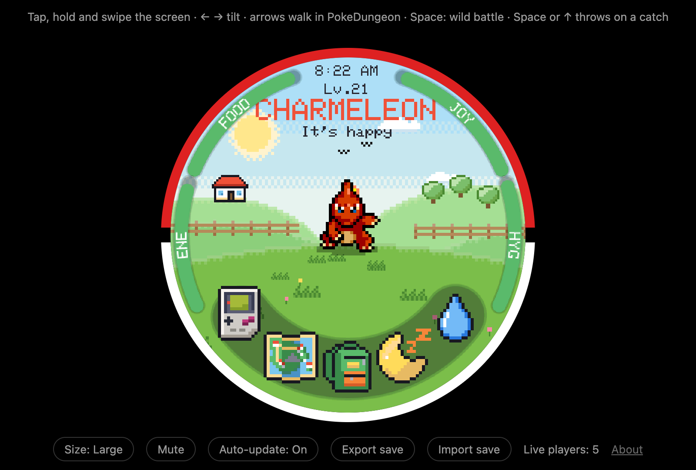

| | | |
|:--:|:--:|:--:|
| 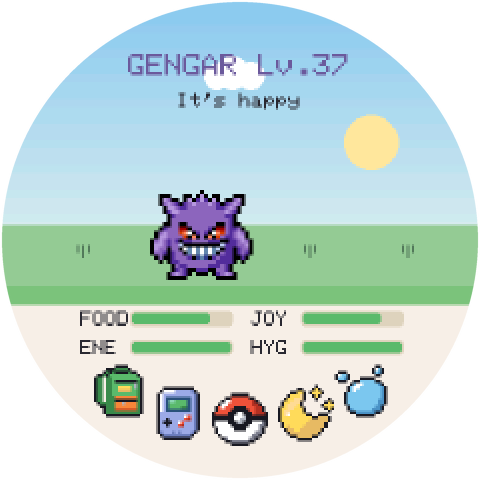 | 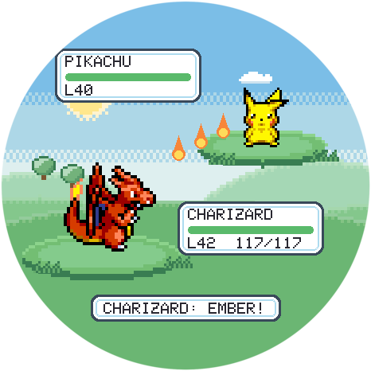 |  |
| **Raise your Pokémon** | **Battle wild Pokémon** | **Catch what you beat** |
| 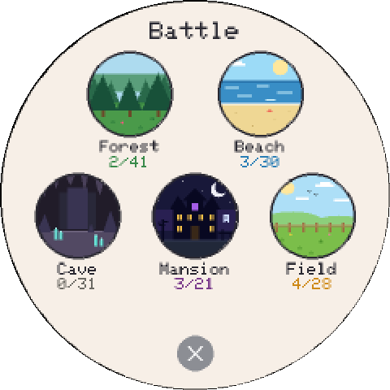 | 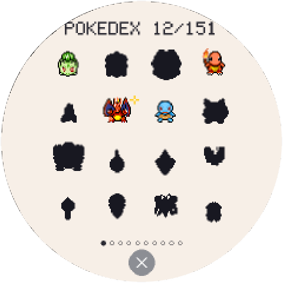 | 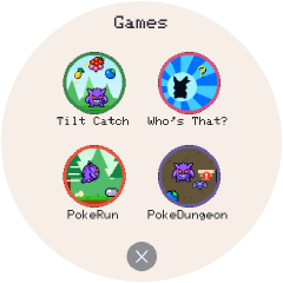 |
| **Choose where to hunt** | **Fill the Pokédex** | **Play mini games** |
| 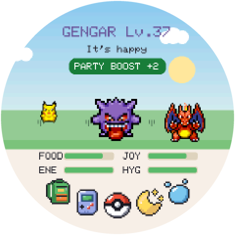 | 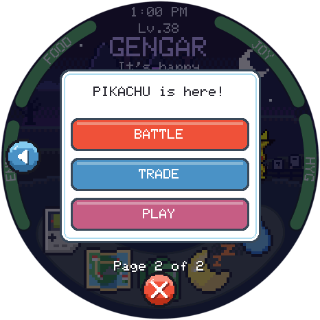 | 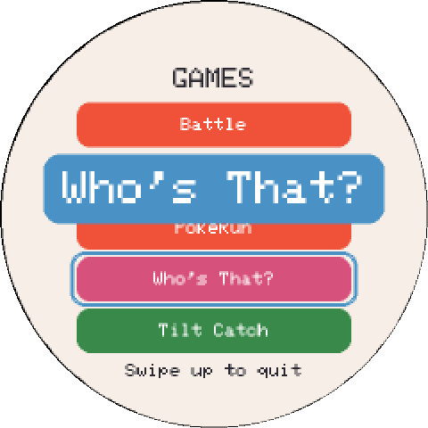 |
| **Buddies come to play** | **Battle or trade with them** | **Press and slide to choose** |
|  |  |  |
| **Play together** | **Who's That? Showdown** | **Poké Ball Volley** |
| 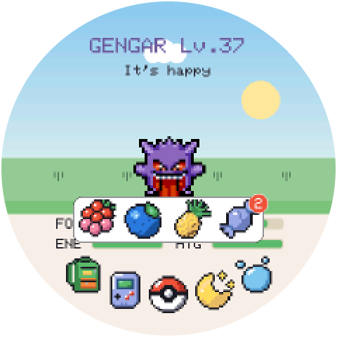 | 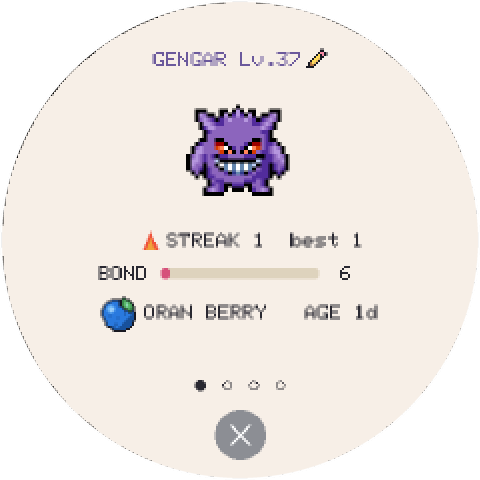 |  |
| **Feed it berries and candy** | **Its card and favorite berry** | **Catch the shiny ones too** |
|  |  |  |
| **Achievements, a swipe away** | **Stats, training and battle wins** | **How close it is to evolving** |

## On your phone

Open [pokewebgochi.3dprintsos.com](https://pokewebgochi.3dprintsos.com) and tap **Share → Add to Home Screen** (iPhone) or **Install app** (Android). It gets its own icon and opens full screen, like an app.

Tap, hold and swipe the screen, and tilt your phone to aim a Poké Ball. iPhones ask once whether the page may use motion. On Android, the phone buzzes softly with taps, meals, medals and catches; the **Vibration** button under the screen turns it off.

## How to play

- **Tap your Pokémon** to pet it. The buttons along the bottom feed it, open the games, turn off the light at bedtime and give it a bath.
- **Swipe up** for its card and stats (tap its name there to rename it), **from left to right** for the Pokédex, **from right to left** for your achievements, and **down** for the clock and settings. The round **✕** at the bottom closes any of them.
- **Battle** from the games menu: pick a zone, search, and catch what you beat to fill your Pokédex. Land the Poké Ball in the small green circle and the catch is sure.
- On a computer, the mouse is a finger: it presses when you click. The **left and right arrows** tilt, **all four arrows** walk in PokeDungeon, and **Space** starts a wild battle.

## Training

- **Winning a battle** adds attack training.
- **Every 12 hours in a row of good care** adds defense training.
- **Mini games** add speed training.
- **Weight** goes up with food (candy the most) and down with play. Over 50, your Pokémon tires twice as fast.

Each one stops at 100. The **Training** page on your Pokémon's card shows how far along each one is, and says **MAX** when it's full.

## Your save

Your Pokémon is saved in this browser automatically. Clearing the browser's data erases it, so use **Export save** now and then for a backup file. **Import save** brings it back, or moves your Pokémon to another browser or computer. The game plays in one tab at a time, and a new version arrives by itself the next time you open it.

## Buddies

Anyone else playing on the same home Wi-Fi shows up on your screen: up to four at once. Tap one to battle, trade Pokédex entries, or **play** a game together: in **Who's That? Showdown** you both see the same silhouette and race to name it first, and in **Poké Ball Volley** your screens are the two halves of one court. Trades are a real swap: the Pokémon you give leaves your Pokédex. Shinies (about 1 wild Pokémon in 50) sparkle, have their own place in the Pokédex and can be traded too. While anyone's around, your Pokémon gets a **Party Boost**: energy drains half as fast, and it has +2 ATK, DEF and SPD in wild battles. Tap the green **PARTY BOOST** button to see who's here, and tap a friend for its stats. A wild Pokémon also visits once a day for an hour, brings a candy and counts for the boost too. 

| 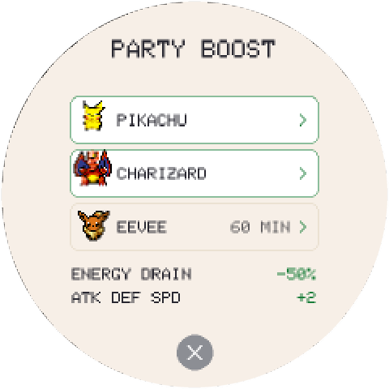 | 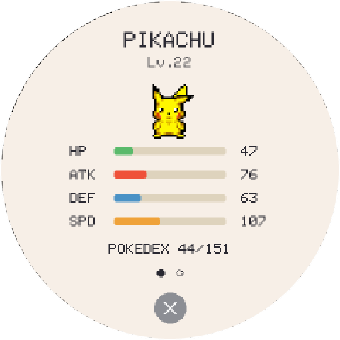 |
|:---:|:---:|
| **Party Boost** | **Tap a friend for its stats** |

You meet players of the browser version, the [Mac app](https://github.com/FedorSosnin/PokeKnomiGochi/releases/latest) and the [BTT Knomi](https://github.com/FedorSosnin/PokeKnomiGochi) handheld alike. Only your Pokémon's species, level, nickname and Pokédex are shared, and only with devices on your network.

## Want a real one?

 

The same game runs on the **BIGTREETECH Knomi V2**, a little round touchscreen made for 3D printers. Put it in a 3D-printed Poké Ball case and you have a pocket tamagotchi that tilts, buzzes and meets the browser and Mac players as buddies.

1. **Get a Knomi V2:** [BIGTREETECH Knomi V2](https://www.awin1.com/pclick.php?p=43148197656&a=2034499&m=95665). This is an affiliate link from [deals.3dprintsos.com](https://deals.3dprintsos.com): buying through it supports this project at no extra cost to you.
2. **Install the game** from your browser with the [web installer](https://fedorsosnin.github.io/PokeKnomiGochi/) (Chrome or Edge, a USB-C data cable). After that it updates itself over Wi-Fi.
3. **Print the case:** download [`PokeKnomiGochi-case.3mf`](https://github.com/FedorSosnin/PokeKnomiGochi/raw/main/print/PokeKnomiGochi-case.3mf), ready to print in red, white and black. It's a remix of [Knomi V2 Creality K1 wall holder / table stand](https://www.printables.com/model/850244-knomi-v2-creality-k1-wall-holder-table-stand) by [Nastra](https://www.printables.com/@Nastra_283431), with a new button and rounded back, shared under [CC BY-NC 4.0](https://creativecommons.org/licenses/by-nc/4.0/): free to print and remix with credit, not to sell.

More in the [PokeKnomiGochi README](https://github.com/FedorSosnin/PokeKnomiGochi#3d-printed-case).

## Also on a Mac

**PokeMacGochi** is the same game as a small round window on your Mac desktop: [download it](https://github.com/FedorSosnin/PokeKnomiGochi/releases/latest). Everything starts from [**PokeKnomiGochi**](https://github.com/FedorSosnin/PokeKnomiGochi).

## Credits

Based on [**TamaPoke**](https://github.com/socquique/TamaPoke) by Quique Tortosa. Sprites from [PMD SpriteCollab](https://github.com/PMDCollab/SpriteCollab) under CC BY-NC 4.0. Pokémon © Nintendo / Game Freak / The Pokémon Company; this is a free, unofficial fan project for personal, non-commercial use.

Made by [Fedor](mailto:fedor@3dprintsos.com) · [YouTube](https://youtube.com/3dprintsos)

*These are built files. The source and how to build them are in [FedorSosnin/PokeKnomiGochi](https://github.com/FedorSosnin/PokeKnomiGochi) (`webgame/`), which updates this repository with `tools/publish_web.sh`.*
