# PokeWebGochi

**A Pokémon virtual pet in your browser.** Raise one of the original 151, battle and catch wild Pokémon, fill your Pokédex, play mini games and meet your buddies. Free, with nothing to install.

### [▶ Play now at pokewebgochi.3dprintsos.com](https://pokewebgochi.3dprintsos.com)

| | | |
|:--:|:--:|:--:|
|  |  | 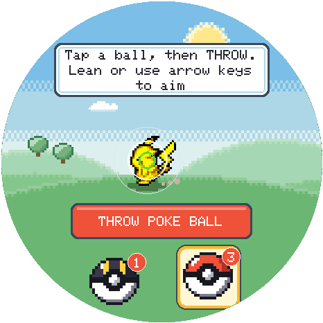 |
| **Raise your Pokémon** | **Battle wild Pokémon** | **Catch what you beat** |
| 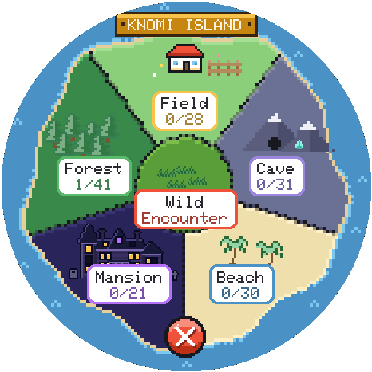 |  |  |
| **Choose where to hunt** | **Fill the Pokédex** | **Play mini games** |
| 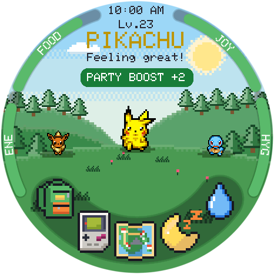 |  | 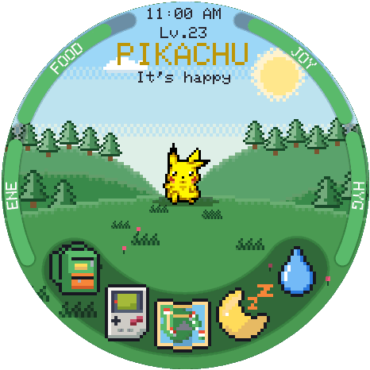 |
| **Buddies come to play** | **Battle, trade or play with them** | **Hold it for a menu** |
| 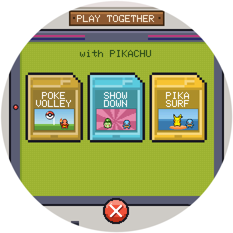 | 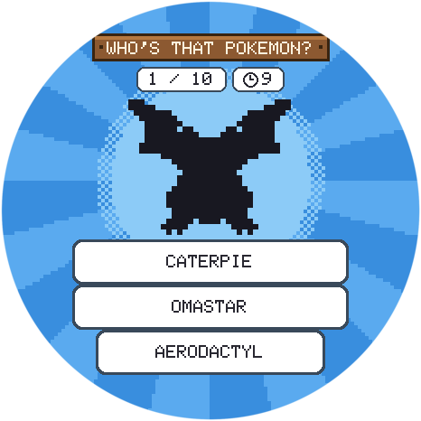 | 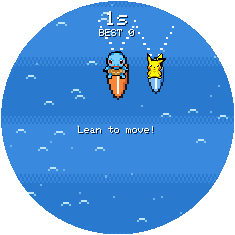 |
| **Play together** | **Who's That Pokémon?** | **PikaSurf** |
| 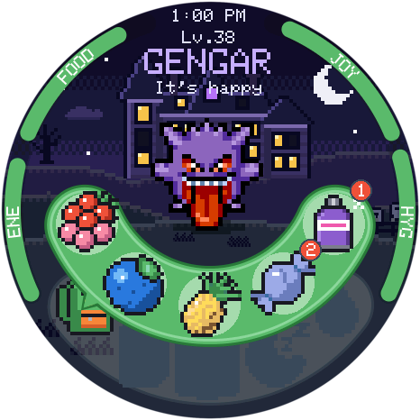 | 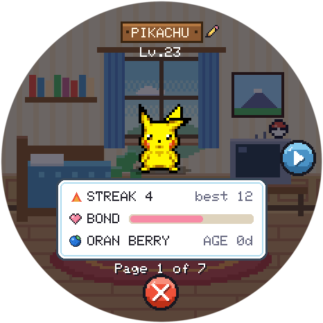 | 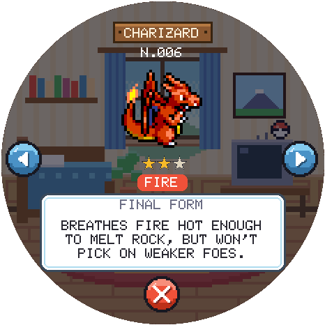 |
| **Feed it from the backpack** | **Its card and favorite berry** | **Every entry turns round** |
| 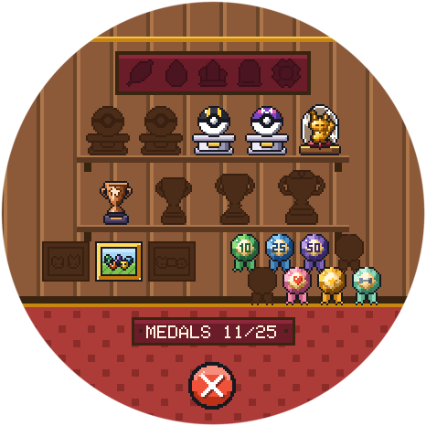 | 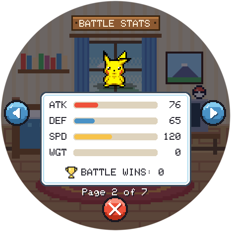 | 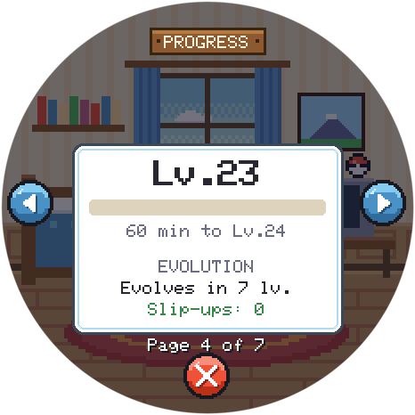 |
| **A trophy room of medals** | **Stats and battle wins** | **How close it is to evolving** |

## On your phone

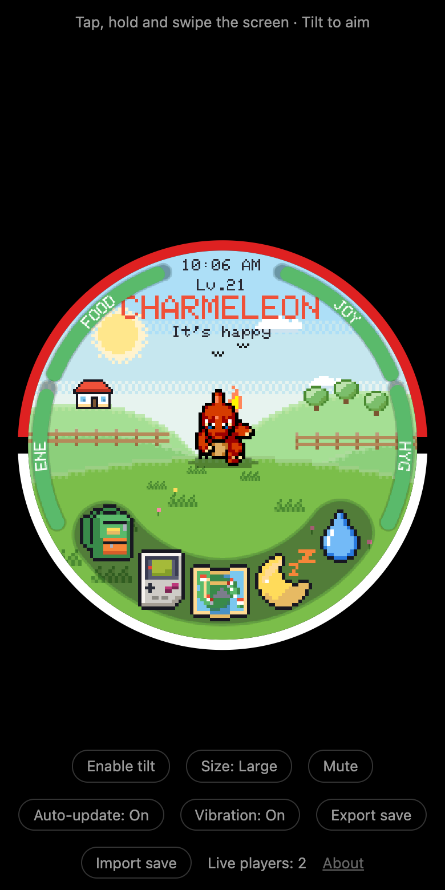

Open [pokewebgochi.3dprintsos.com](https://pokewebgochi.3dprintsos.com) and tap **Share → Add to Home Screen** (iPhone) or **Install app** (Android). It gets its own icon and opens full screen, like an app.

Tap, hold and swipe the screen, and tilt your phone to aim a Poké Ball. iPhones ask once whether the page may use motion. On Android, the phone buzzes softly with taps, meals, medals and catches; the **Vibration** button under the screen turns it off.

## How to play

- **Tap your Pokémon** to pet it. The icons along the bottom, from left to right, open your bag to feed it, open the mini games, start a battle, turn off the light at bedtime and give it a bath.
- **Hold your Pokémon** for a ring of Settings, Medals, Stats and the Pokédex. You can also **swipe up** for its card and stats (tap its name there to rename it), **from left to right** for the Pokédex, **from right to left** for the trophy room, and **down** for the clock and settings. The round **✕** at the bottom closes any of them.
- **Battle** with the map icon: travel to a zone and search, or tap **Wild Encounter** to meet a wild Pokémon at your Pokémon's home, and catch what you beat to fill your Pokédex: tap a ball to throw it at the Pokémon running back and forth, leaning (or using the arrow keys) to aim. Every catch has 1 to 3 ★, and a better one replaces yours. Every 25 battles you see through earn an **Ultra Ball**, which triples the chance, and every 100 a **Master Ball**, which always catches.
- On a computer, the mouse is a finger: it presses when you click, and what's under it lifts a little. The **left and right arrows** tilt, **all four arrows** walk in PokeDungeon, and **Space** starts a wild battle.

## Training

- **Winning a battle** adds attack training.
- **Every 6 hours of good care** adds defense training.
- **Mini games** add speed training.
- **Weight** goes up with food (candy the most) and down with play. Over 50, your Pokémon tires twice as fast.

Each one stops at 100. The **Training** page on your Pokémon's card shows how far along each one is, and says **MAX** when it's full.

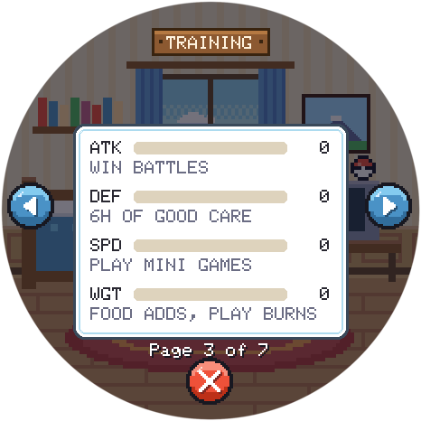

## Moves

Your Pokémon fights with two moves: on the right the strongest of its own type, on the left the strongest of any other type. They are the attacks its species learns in Pokémon Red and Blue, up to its level, and it gains a level every hour, asleep or awake. Only levels teach moves, not training or wins. When a stronger one takes over a button, the next wild battle opens with **Learned …!** A Charmander starts with Scratch, learns Ember at level 9, Slash at 30 and Flamethrower at 38. The [moves chart](https://github.com/FedorSosnin/PokeKnomiGochi/blob/main/docs/MOVES.md) has each move's power and every Pokémon's moves and the level it evolves at.

## Your save

Your Pokémon is saved in this browser automatically. Clearing the browser's data erases it, so use **Export save** now and then for a backup file. **Import save** brings it back, or moves your Pokémon to another browser or computer. The game plays in one tab at a time, and a new version arrives by itself the next time you open it.

## Buddies

Anyone else playing on the same home Wi-Fi shows up on your screen: up to four at once. Tap one to battle, trade Pokédex entries, or **play** a game together: in **Who's That? Showdown** you both see the same silhouette and race to name it first, and in **Poké Ball Volley** your screens are the two halves of one court. Trades are a real swap: the Pokémon you give leaves your Pokédex. Shinies (about 1 wild Pokémon in 100) sparkle, have their own place in the Pokédex and can be traded too. While anyone's around, your Pokémon gets a **Party Boost**: energy drains a quarter slower, and it has +2 ATK, DEF and SPD in wild battles. Tap the green **PARTY BOOST** button to see who's here, and tap a friend for its stats. A wild Pokémon also visits once a day for an hour, brings a candy and counts for the boost too. 

| 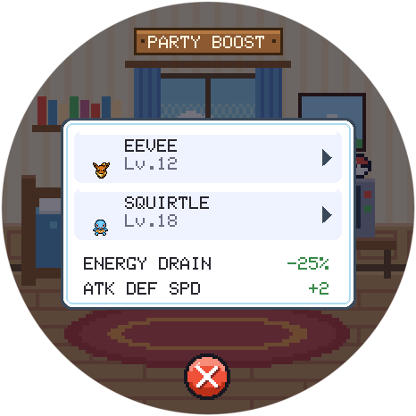 |  |
|:---:|:---:|
| **Party Boost** | **Tap a friend for its stats** |

You meet players of the browser version, the [Mac and Windows apps](https://github.com/FedorSosnin/PokeKnomiGochi/releases) and the [BTT Knomi](https://github.com/FedorSosnin/PokeKnomiGochi) handheld alike. Only your Pokémon's species, level, nickname and Pokédex are shared, and only with devices on your network.

## Want a real one?

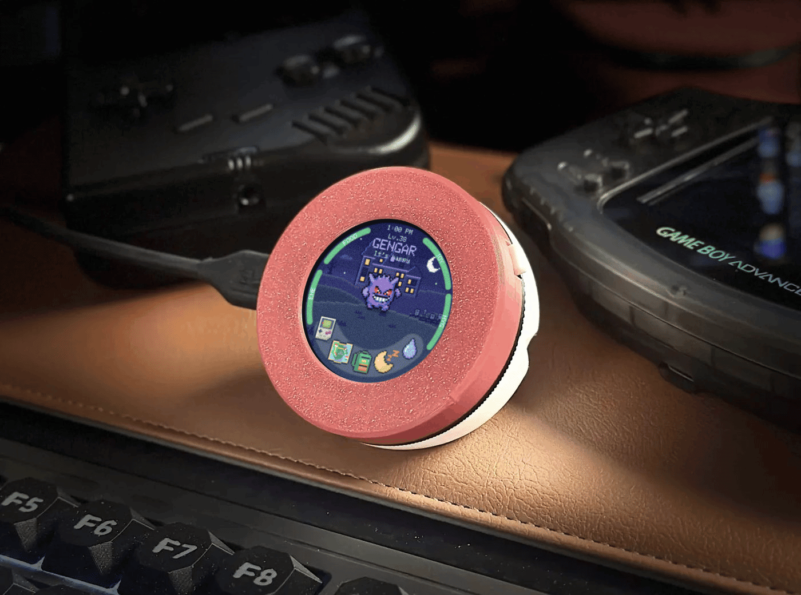

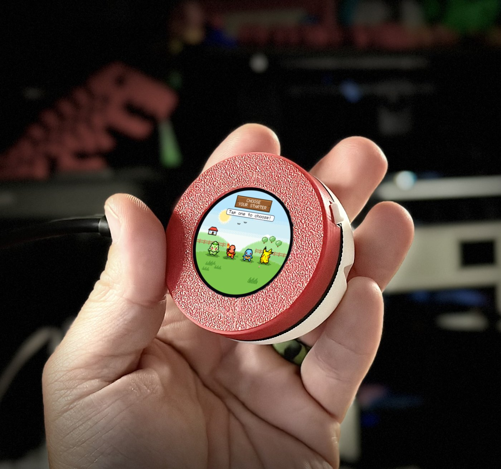 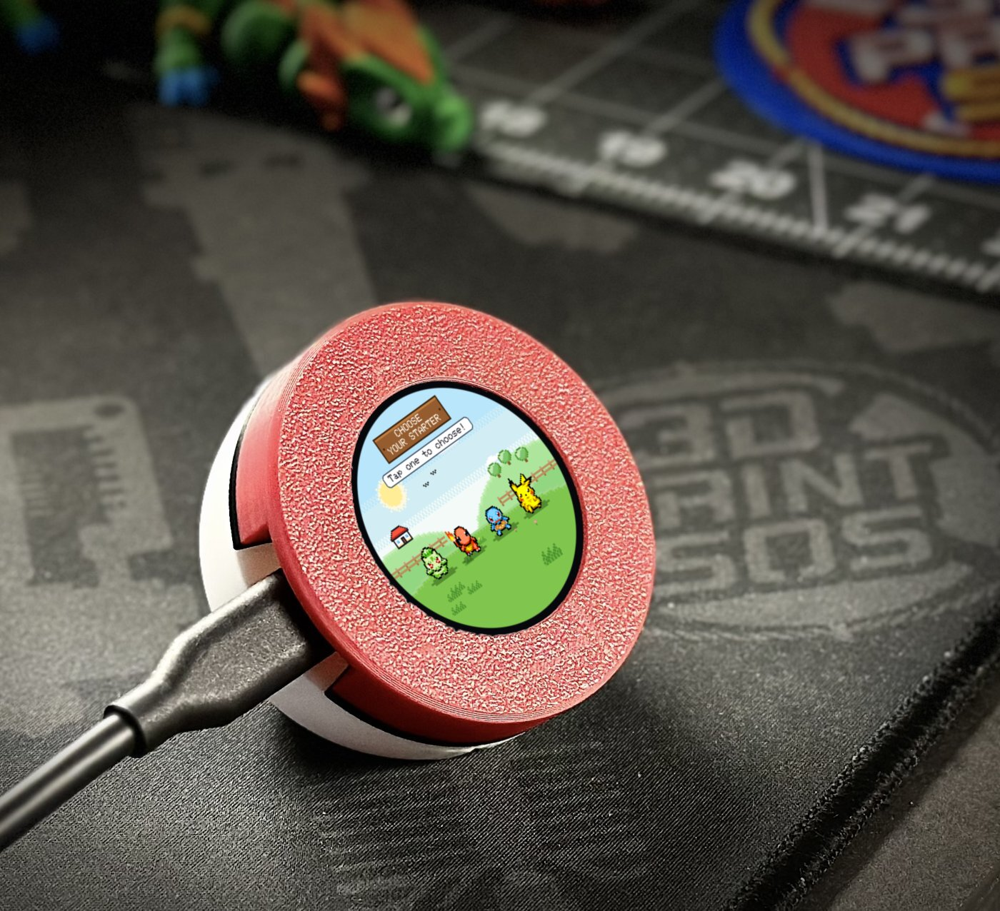

The same game runs on the **BIGTREETECH Knomi V2**, a little round touchscreen made for 3D printers. Put it in a 3D-printed Poké Ball case and you have a pocket tamagotchi that tilts, buzzes and meets the browser, Mac and Windows players as buddies.

1. **Get a Knomi V2:** [BIGTREETECH Knomi V2](https://www.awin1.com/pclick.php?p=43148197656&a=2034499&m=95665). This is an affiliate link from [deals.3dprintsos.com](https://deals.3dprintsos.com): buying through it supports this project at no extra cost to you.
2. **Install the game** from your browser with the [web installer](https://fedorsosnin.github.io/PokeKnomiGochi/) (Chrome or Edge, a USB-C data cable). After that it updates itself over Wi-Fi.
3. **Print the case:** download [`PokeKnomiGochi-case.3mf`](https://github.com/FedorSosnin/PokeKnomiGochi/raw/main/print/PokeKnomiGochi-case.3mf), ready to print in red, white and black. It's a remix of [Knomi V2 Creality K1 wall holder / table stand](https://www.printables.com/model/850244-knomi-v2-creality-k1-wall-holder-table-stand) by [Nastra](https://www.printables.com/@Nastra_283431), with a new button and rounded back, shared under [CC BY-NC 4.0](https://creativecommons.org/licenses/by-nc/4.0/): free to print and remix with credit, not to sell.

More in the [PokeKnomiGochi README](https://github.com/FedorSosnin/PokeKnomiGochi#3d-printed-case).

## Also on Mac and Windows

**PokeMacGochi** and **PokeWinGochi** are the same game as a small round window on your Mac or Windows desktop: [download them](https://github.com/FedorSosnin/PokeKnomiGochi/releases). Everything starts from [**PokeKnomiGochi**](https://github.com/FedorSosnin/PokeKnomiGochi).

## Credits

Sprites from [PMD SpriteCollab](https://github.com/PMDCollab/SpriteCollab) under CC BY-NC 4.0. Pokémon © Nintendo / Game Freak / The Pokémon Company; this is a free, unofficial fan project for personal, non-commercial use.

Made by [Fedor](mailto:fedor@3dprintsos.com) · [YouTube](https://youtube.com/3dprintsos)

*These are built files. The source and how to build them are in [FedorSosnin/PokeKnomiGochi](https://github.com/FedorSosnin/PokeKnomiGochi) (`webgame/`), which updates this repository with `tools/publish_web.sh`.*
